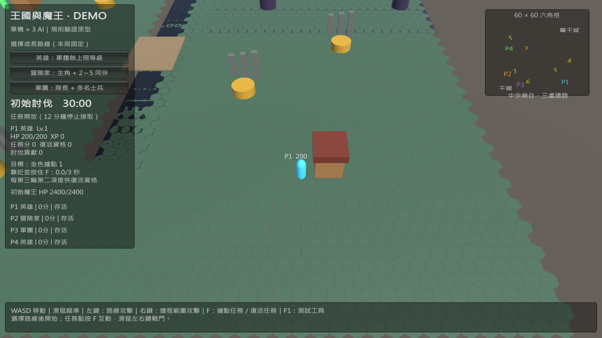

# DEMO 驗證紀錄（2026-10-23）

- 純 C# 規則測試：25 項 assertion 通過，涵蓋任務截止、貢獻有效傷害、選路權、暫停、獨立終局、任務復活、魔化勝負與護送結算。
- Unity 6000.0.39f1：重新匯入與編譯成功；AsymmetricDemo 場景載入並進入 Play，Console 錯誤數 0。
- Unity Play 加速 AI 對局完成護送與總分結算：P4 勝出，最終分數 P4=340、P3=240、P2=160、P1=80。包含任務得分、討伐貢獻及聖器持有者轉手。這是單次本機原型驗證。
- Windows x64：Build Finished, Result: Success；輸出約 109.62 MB，189 秒。輸出位置 GamePJ260820/Builds/AsymmetricDemo/AsymmetricDemo.exe。
- Windows 建置與 Play 測試使用目前本機 Unity 專案；此次 Git 變更沒有包含其他尚未提交的材質、動畫與 MCP 設定。純規則測試另於提交用 checkout 執行。
- 正式多人連線、完整 RTS、天賦與任務系統接入，以及 Windows 執行檔人工操作驗收仍待後續。

